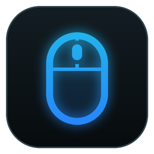

# SpathaRE



A lightweight Windows tray app that configures the **original 2016 ASUS ROG
Spatha** without Armoury Crate. As far as I know it's the first tool that can.
The mouse's USB protocol was reverse engineered from Armoury Crate's DLLs and
checked on a real mouse; the write-up is in [PROTOCOL.md](PROTOCOL.md).

I also own a **Spatha X**, so the app supports it too. That support is borrowed
from [G-Helper](https://github.com/seerge/g-helper), which already knew how to
talk to it, and shares the same settings window.

| Mouse | USB IDs | Protocol |
|---|---|---|
| ROG Spatha (original, 2016) | wired `0B05:181C`, dock `0B05:1824` | own, reverse engineered ([PROTOCOL.md](PROTOCOL.md)) |
| ROG Spatha X | wireless `0B05:1979`, wired `0B05:1977` | G-Helper's AsusMouse (vendored) |

## Features

* An Armoury-style **button map**: click a button on the mouse art (or its
  callout) and pick what it does: mouse functions, combos (key combinations such
  as Alt+Tab, editable), multimedia keys, single keys or the DPI switch. Both
  mice use the same categories, names and combos.
* **DPI** stages, polling rate, angle snapping, acceleration, button response.
* **Lighting** per zone (logo, scroll wheel, base), sleep timer, low-battery
  alert, battery level.
* **Onboard profiles**: switch from the window, the tray popup or global
  hotkeys. Hover a profile number to see, in red, which buttons switch to it on
  the mouse itself.
* **Export / import** button settings and DPI, one profile or the whole set,
  **across models**: a Spatha profile can go onto a Spatha X and back.
* **Several mice at once**: pick one in the sidebar or tray popup.
* Hotkeys and app options are set in the app (Settings → Hotkeys).

Close Armoury Crate while using SpathaRE. Both programs talking to the mouse at
the same time works, but they overwrite each other and everything gets slow.

## Using it

### Combos (key combinations)

Both mice handle combinations the same way. The **Combos** tab under Buttons
lists twelve combos, shown as e.g. `Alt+Tab (F13)`: the keys typed, then the
spare key in brackets. A combo button makes the mouse send that spare key
(F13-F24) and SpathaRE types the real combination, so this needs SpathaRE
running.

To change what a combo types, give a button that combo, then use the *Edit
combo* box below the list: click it, press the keys together, *Save keys*.
Combinations Windows keeps for itself, like Alt+Tab, can be typed instead: click
the box, press Backspace and type `Alt+Tab`. The twelve combos are shared by both
mice and every profile, so changing F13 changes it everywhere.

### Profiles

Both mice keep their settings in onboard profiles: the original Spatha has 6,
the Spatha X 5. The window always edits the **active** profile.

Both switch profiles by themselves when you **hold the DPI button and press a
side button**. Side buttons are numbered as on the button map: top row 1-2-3,
bottom row 4-5-6, front to back.

| Profile | On the mouse |
|---|---|
| 1 | DPI + side button 1 |
| 2 | DPI + side button 3 |
| 3 | DPI + side button 6 |
| 4 | DPI + side button 5 |
| 5 | DPI + side button 4 |
| 6 (original Spatha only, "Default") | DPI + side button 2 |

Neither mouse is easy to follow when it does this, so SpathaRE checks the active
profile in the background (and listens for the event the Spatha's dock sends),
then reloads the window and shows a tray notification.

Profile 6 on the original Spatha is its factory "Default". Armoury Crate never
writes it, so SpathaRE shows it greyed out and read-only. Setting
`"spatha_allow_default_profile": 1` in the config unlocks it.

### Export and import

*Export* (next to the profile numbers) saves the button functions and DPI of the
active profile, or of all profiles, to a `.json` file. *Import* writes a file
back: a single profile goes into the active profile, a set goes into the same
profile numbers.

Files work across models. Buttons are matched by position, so side button 3
stays side button 3, and DPI stages 1 and 2 are copied (the original Spatha has
two). Anything the target can't do is left unchanged and listed afterwards:
"Side button" functions and double click only exist on the Spatha X. Combos are
saved as the keys they type and land on the combo that types the same keys, or
on a free one.
Lighting and the other settings are not included on purpose; the two models
store them too differently to move safely.

### Wireless (original Spatha)

The dock relays every request to the mouse over radio, and single requests time
out now and then even while the mouse works fine. SpathaRE keeps showing the
mouse until it has been silent for a minute, counts anything the dock sends
(battery, put on / taken off the dock, profile and DPI changes) as a sign of
life, and checks a sleeping mouse every couple of seconds with a single request,
so it's back within seconds of moving it.

## Config

`%APPDATA%\SpathaRE\config.json`, written by the app. Everything below is also
editable in Settings → Hotkeys; the file is only needed for the advanced keys.

| Key | Default | |
|---|---|---|
| `hotkey_profile_1` … `hotkey_profile_6` | `Ctrl+Alt+1` … `Ctrl+Alt+6` | switch the selected mouse's profile; `""` turns one off |
| `hotkey_profile_next` / `_prev` | `Ctrl+Alt+OemPlus` / `OemMinus` | next / previous profile |
| `hotkey_popup` | `Ctrl+Alt+M` | show the tray popup |
| `notify_profile_change` | `1` | tray notification when the profile is switched on the mouse |
| `mouse_combo_F13` … `mouse_combo_F24` | see the Combos tab | keys each combo types (`Ctrl+C` or hex virtual keys `0xA2 0x43`) |
| `combo_hold_ms` | `10` | how long combo keys are held down |
| `profile_poll_ms` | `1500` | how often the active profile is checked; `0` turns it off |
| `spatha_allow_default_profile` | `0` | allow writing the original Spatha's Default profile |
| `usb_packet_logger` | `0` | log every Spatha X USB packet, for troubleshooting |

Hotkey gestures use WPF key names (`F13`, `NumPad1`, `OemPlus`, `OemTilde`).

## Build

```powershell
dotnet build -c Release
dotnet publish -c Release -r win-x64 -p:Platform=x64
dotnet publish -c Release -r win-arm64
```

Requires the .NET 8 SDK. The output is a framework-dependent single file; add
`-p:SelfContained=true` if you'd rather not install the runtime. Nothing native
is compiled, so either architecture can be built from either machine.

## Tests

```
cd SpathaRE.Tests
dotnet run
```

Runs the original Spatha's protocol and device code against a simulated mouse:
busy and stale replies, dropped writes, profile switching, battery, patchy
wireless, export / import. Pure .NET, so it also runs on Linux and macOS.

## Repository

| Path | What |
|---|---|
| `SpathaRE/` | the app (WPF, .NET 8) |
| `SpathaRE/Core/Spatha/` | original Spatha: memory layout, protocol, HID transport, device |
| `SpathaRE/Core/Devices/` | the model both mice share, button names, export format, Spatha X adapter |
| `SpathaRE/Core/Mouse/`, `Core/Usb/` | Spatha X support, vendored from G-Helper |
| `SpathaRE/UI/` | settings window, button map, tray popup |
| `SpathaRE.Tests/` | tests against a simulated Spatha |
| `PROTOCOL.md` | the original Spatha's USB protocol |
| `tools/python/` | `spatha.py`, the command-line tool used to decode and test the protocol |

## Credits

* [G-Helper](https://github.com/seerge/g-helper) by **seerge and contributors**:
  the Spatha X support, the HID code underneath it, and a lot of the ideas.
  Thank you.
* Original Spatha protocol: reverse engineered from Armoury Crate's
  `IfSpatha.dll`, `SPATHA HID Library`, `SPATHA SYNC Dll` and
  `AacMouseExternHal`, verified on a real mouse.
* Button-map artwork: line renders of the ROG Spatha.

## Licence

GPL-3.0, inherited from G-Helper. Original G-Helper code © seerge and contributors.
